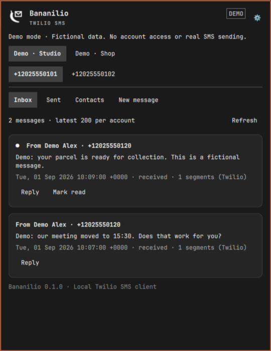
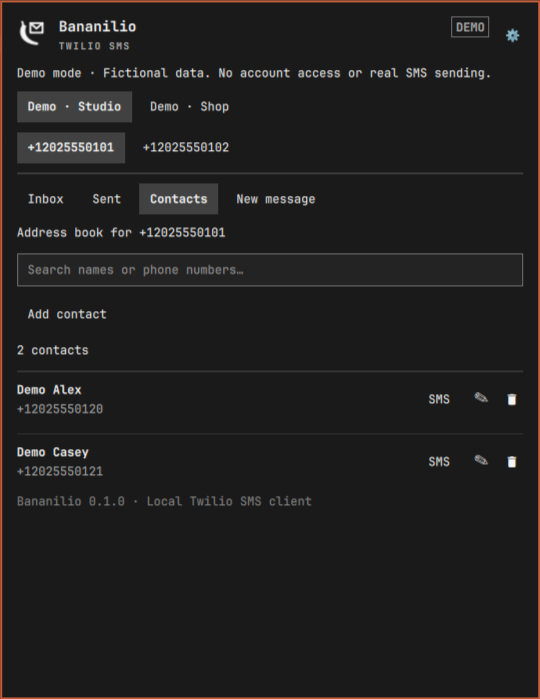
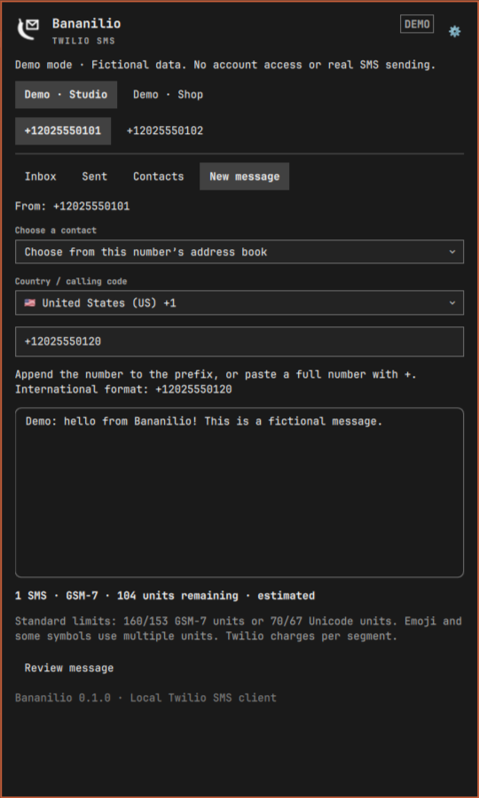
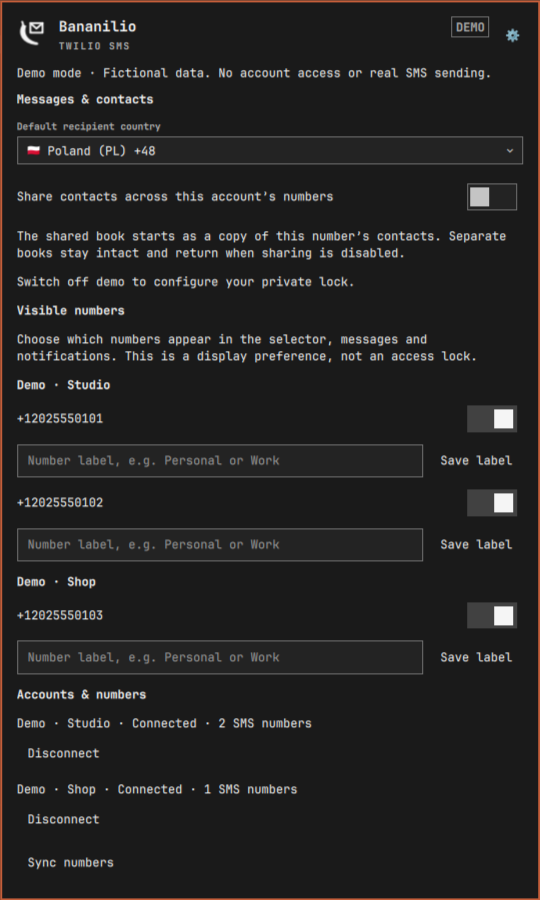

# Bananilio

SMS, with a banana twist. A standalone Twilio SMS plugin for the Omarchy bar.

- Inbox and sent history, with account and sender-number selection.
- Compose and reply, with an explicit recipient/content preview before sending.
- Multiple accounts; discover all their SMS-enabled Twilio numbers.
- In-panel account setup, number sync, notification and polling settings.
- Generic new-message notifications, without message content or phone numbers.
- Isolated demo mode with fictional messages and simulated sending.


## Install

Requires Omarchy with its Quickshell plugin system and Python 3. No Python packages,
remote host, SSH session or separately installed service are needed at runtime.
Encrypted storage additionally requires the official Arch `sqlcipher` package:

```sh
omarchy pkg add sqlcipher
```

Standard storage does not require SQLCipher.

Install from the public repository:

```sh
omarchy plugin add https://github.com/blazejkapala/omarchy-bananilio.git --enable
```

For a manual installation, place this directory at `~/.config/omarchy/plugins/banan.bananilio`, then run:

```sh
omarchy plugin validate ~/.config/omarchy/plugins/banan.bananilio
omarchy-shell shell rescanPlugins
omarchy plugin enable banan.bananilio --section right
```

If a source update is not reflected in the UI, run `omarchy restart shell`.

## Remove

Run `omarchy plugin remove banan.bananilio` in a terminal and confirm removal.
This removes the plugin, but preserves local data for a future reinstall.
After closing the plugin, you can separately delete `~/.config/bananilio` and
`~/.local/state/bananilio` if you no longer need the credentials, contacts or vault.
Respect custom XDG paths and keep any desired encrypted backup first.
Removal does not delete anything from your Twilio account.

## Set up an account

On first launch, choose **Use encrypted storage** or **Use standard storage**,
then choose **Connect Twilio account**. For additional accounts,
open the gear → **Add Twilio account**. Enter a label of your choice,
the Account SID and Auth Token from Twilio Console. **Connect account** checks access
and discovers SMS-enabled numbers. Reusing an Account SID updates its name/token.
Repeat for another account. Add or purchase numbers in Twilio Console, then
use **Sync numbers** here. The plugin does not purchase numbers.

Select a number at the top before choosing **Inbox**, **Sent** or **New message**.
With multiple accounts, an account selector appears above the numbers. Each
number has its own in-memory message draft. Switching numbers updates both
message lists and the sender; switching is disabled during review or sending.

Use the gear → **Visible numbers** to choose which numbers appear. Hidden
numbers are excluded from message lists, unread counts and notifications, and
cannot send until shown again. Once a visibility selection is saved for an
account, newly discovered numbers stay hidden until selected. This is a display
preference, not an access lock. Visibility is stored privately in
`~/.config/bananilio/visibility.json` in standard mode, or inside the encrypted vault.
Recipients must use international format, such as `+12025550120`.
**Review message** shows the exact sender, recipient and text; only
**Confirm and send** submits it to Twilio. Accepted/queued does not mean delivered.
Refresh Sent for the current status. Twilio account restrictions and charges apply.

## SMS segment estimate

New message shows a live segment estimate, encoding, and remaining units in the
current segment. It counts GSM-7 extension symbols as two units and Unicode as
UTF-16 units, keeping surrogate pairs together. Standard limits are 160/153 for
GSM-7 and 70/67 for Unicode. Toll-free senders to +1 destinations use a conservative
152/66 multipart estimate. Carrier behavior, complex emoji grouping and any
provider text transformations can affect the final result; the estimate is not a
billing guarantee. Message history displays Twilio’s returned `num_segments` when
available.

Characters requiring Unicode are listed. **Preview without Polish letters** shows
an alternative plus its estimate; **Use this version** explicitly replaces the
draft. Emoji and other non-Polish Unicode characters are preserved. No replacement
is automatic. The editor limit is 1600 UTF-16 units.

Run calculator checks with `node test_segments.cjs`.

## Calling codes, contacts and number labels

**New message** includes searchable country calling codes with flags. Selecting a
country inserts its prefix; append the remaining international-format number or
paste a full `+` number. Spaces, parentheses and hyphens are removed for the review
and send request; `00` is converted to `+`. Review always shows the actual complete
recipient. Countries can share a calling code, so a flag does not verify where a
number is registered. Set the initial selection under the gear → **Default
recipient country**. The initial default is Poland (+48). Existing drafts keep
their chosen prefix. Calling-code data is bundled locally; see THIRD_PARTY.md.

**Contacts** supports search, adding, editing and confirmed deletion. Choose
**Message** on a contact or use **Choose a contact** in New message. Imported
non-telephone sender IDs remain visible but cannot be selected as SMS recipients.
Each sending number has a separate local address book by default. Under the gear,
**Share contacts across this account’s numbers** switches to an account-wide shared
book. The first switch copies the selected number’s book; later switches reuse the
shared book. Separate books are retained and return when sharing is disabled;
changes in shared mode do not overwrite them. Disconnecting an account retains its
local address books for reconnection.

Under **Visible numbers**, enter a label and choose **Save label**. Your number
appears as `+… (Work)` in the selector and sender description. Labels are local and
do not change Twilio settings. Contacts and labels live in the private config
directory as `contacts.json` and `number-labels.json` in standard mode, or inside
the encrypted vault. They are never stored in this repository.
Incognito protects these actions and hides contact data when locked.

## Disconnecting and Incognito

In the gear menu, **Disconnect** removes the selected account’s local credentials,
number cache and read state after confirmation. It does not delete the Twilio
account, phone numbers or messages. The send-attempt ledger is retained to prevent
accidental duplicate sending if an account is reconnected. You can reconnect at
any time with your Twilio credentials.

## Storage modes and Incognito

Choose a storage mode on first launch. Existing installations also receive this
choice; their existing Incognito password remains required before private access
or migration. Choosing standard mode does not disable an existing lock.

### Standard storage

Local JSON files are **not encrypted**. Optional **Incognito** hides the panel,
clears drafts, pauses polling and requires a password for private actions.
Its password is stored as a salted scrypt hash (N=16384, r=8, p=1); an expiring
session digest and rate-limit counters are stored privately. Enabling, changing
or disabling this view lock is available under the gear. It does not protect
files from other programs running as your Linux user.

### Encrypted storage

SQLCipher encrypts accounts and Auth Tokens, contacts, labels, visibility, number
cache, read state and the durable send ledger in
`~/.local/state/bananilio/vault.db` (permissions 600). Structured records are stored
in a SQL table inside encrypted pages. SQLCipher provides encryption and key
derivation; Bananilio does not implement its own cipher.

One **master password** opens the vault and unlocks Incognito. No extra plugin
login password is needed; the Twilio Auth Token remains a separate API credential.
There is no saved plaintext password or separate password hash for this mode.
The database salt and authentication are handled by SQLCipher. The key lives in
the local helper process while unlocked. The helper has core dumps disabled;
SQLCipher memory wiping is enabled. Temporary SQL storage stays in memory, and
SQLCipher encrypts database journal pages.

The panel starts locked after shell restart. Inactivity (5–3600 seconds, including
time spent closed) and **Lock now** clear the UI, drafts, credentials and pending
requests, then terminate the helper. The helper also enforces its own inactivity
deadline. Polling never extends it. Unlocking restarts the helper and opens the
vault. Settings allow changing the timeout or master password; leave the new
password blank to keep it. Encryption cannot be disabled with the view-lock button.

A send already submitted to Twilio is not cancelled by locking. Check **Sent**
afterward; the encrypted send-attempt ledger prevents automatic retries even if
the helper was killed during a send. Notifications and polling pause while locked.

### Migration and recovery

Use the gear → **Switch to encrypted storage** to migrate standard storage later.
Enter your current Incognito password if enabled, then enter and confirm the new
master password **in the plugin**, not in a chat or terminal command.
Migration creates a separate encrypted database, commits it, reopens it and checks
its integrity and every imported record before publishing it. Only then are the
verified old JSON files removed. If cleanup is interrupted, unlocking resumes it.
A changed legacy file stops cleanup instead of silently deleting the change.
Failures before publication leave the original files in place.

There is **no password recovery**. Keep your password safely and back up the
closed vault. Forgetting it prevents access to local contacts and credentials.
A reverse conversion/export to unencrypted storage is not currently provided;
choosing standard mode is available before vault creation.

Removing legacy files is not guaranteed secure erasure on SSDs, snapshots or
backups. Existing external backups and data on Twilio or a source machine are
unchanged. Encryption protects a closed database without its password; it does
not isolate this plugin from a malicious program able to modify its code, capture
future passwords, or inspect the unlocked desktop. Python/Qt may retain temporary
memory copies until reclaimed; do not treat this as a hardened secret enclave.

## Privacy and storage

- Standard-mode credentials: `~/.config/bananilio/accounts.json`, mode `600` in a `700` directory.
- Encrypted-mode private data: `~/.local/state/bananilio/vault.db`.
- Non-secret storage-mode selection and password-attempt counters remain outside the vault.
- State: `~/.local/state/bananilio/` (number cache, read IDs and send-attempt ledger).
- These paths respect `XDG_CONFIG_HOME` and `XDG_STATE_HOME` and are outside this repository.
- Credentials are supplied over process stdin, never command-line arguments.
- Network access goes directly to Twilio over HTTPS. Redirects are rejected.
- Message bodies are displayed in memory, not written to the local cache.
- The send ledger stores a payload hash and routing/status metadata, not message text.
- No commands are executed from incoming SMS. SMS-based desktop control is not implemented.

## Demo and screenshots

Enable **Demo mode** in Settings or run:

```sh
omarchy bar set banan.bananilio demo true --json
```

Demo requests bypass local account/state storage and the network entirely.
Sending and account setup are simulations. Use only fictional accounts, reserved example numbers and synthetic English
messages for screenshots; the screenshots below show only these synthetic demo fixtures. Disable demo
to return to your real accounts:

```sh
omarchy bar set banan.bananilio demo false --json
```


## Screenshots

All numbers, contacts and messages shown here are fictional. Demo mode never
connects to Twilio or reads real account storage.






## Limits and troubleshooting

The UI loads the most recent 200 messages per account and filters them by selected
number; it is not a complete archive. New messages are polled while the shell is
running. The first fetch establishes a read baseline. Attachments are counted but
not downloaded. Text is limited to 1600 characters; Twilio may split it into
billable segments.

An interrupted or timed-out send can have an unknown outcome. Check **Sent** before
starting another message. A durable request ID blocks automatic repeats; no send
is automatically retried. Do not delete the send ledger to retry an uncertain send.

## Development

```sh
python3 -m unittest -v test_client test_vault
node test_segments.cjs
omarchy plugin validate .
```

Tests use temporary storage and mocked Twilio responses; they do not send SMS.
Logo and bar icon are native vector/Canvas artwork. License: MIT.
